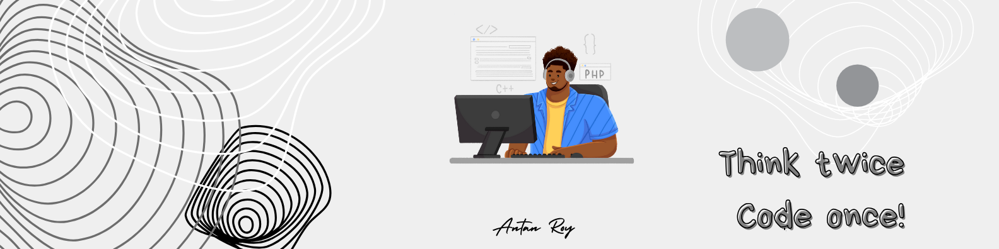

## Hi there 👋 Antan Roy

  

---

## 🌐 Connect with Me:

  
  
  

---

## 💫 About Me:
- 🔭 Currently working on **Web Development**
- 👯 Looking to collaborate on **Full Stack Projects**
- 🌱 Learning **Typescript**
- 💬 Ask me about **JavaScript, React.js, Node.js**
- ⚡ Fun Fact: **Always exploring new tech!**
- 😄 Pronouns: **He/Him**
- 📫 Reach me at **antanroy502@gmail.com**

---

## 💻 Tech Stack:

  <table>
    <tr>
      <td><b>Languages</b></td>
      <td>C++, C, JavaScript, HTML/CSS</td>
    </tr>
    <tr>
      <td><b>Frameworks/Databases</b></td>
      <td>React.js, Next.js, Node.js, Express.js, Bootstrap, Tailwind Css, REST API, MongoDB, PostgreSQL, Socket.io</td>
    </tr>
    <tr>
      <td><b>Tools</b></td>
      <td>Visual Studio Code, GitHub, Postman</td>
    </tr>
    <tr>
      <td><b>Soft Skills</b></td>
      <td>Problem Solving, Self-learning, Time Management, Adaptability, Communication</td>
    </tr>
  </table>

---

## Holopin(24) Badges 🪶

  

---

### 📌 Codolio Profile:

  

---

  

